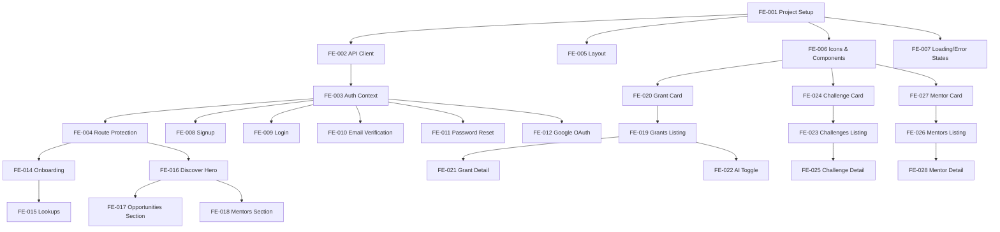

# Outpost Frontend – Story Backlog

Every UI story you build, with what 'done' means. **Core** stories are mandatory; **Optional** are the safety valve.

> **Conventions:** Next.js 14+ App Router; TypeScript strict mode; Tailwind CSS only (no inline styles); shadcn/ui components; fetch for API calls; package by feature; mobile-first responsive; accessible (WCAG AA).

> **API:** Backend at `http://localhost:8080`; Swagger at `/swagger-ui.html`; all `/api/v1/**` endpoints except public listings require JWT Bearer token.

---

## F0 Foundation

### FE-001 · Project setup: Next.js + TypeScript + Tailwind + shadcn/ui

**Week 1 · Core**

A running Next.js application with the design system configured and ready for features.

**Acceptance criteria**

- [ ] Next.js 14+ with App Router, TypeScript strict mode, Tailwind CSS configured
- [ ] shadcn/ui initialized with the Outpost color palette from `STYLE_GUIDE.md`
- [ ] Manrope font loaded via `next/font/google`
- [ ] `tailwind.config.ts` extended with Outpost design tokens (colors, spacing, border-radius)
- [ ] Base layout with warm off-white background (`#f8f8f5`)
- [ ] ESLint + Prettier configured; `npm run lint` passes
- [ ] Environment variables: `NEXT_PUBLIC_API_URL` for backend
- [ ] `.env.example` with all required variables documented
- [ ] `README.md` with setup instructions

**Structure**

```
src/
  app/
    layout.tsx
    page.tsx
  components/
    ui/           # shadcn components
  lib/
    utils.ts      # cn() helper
  styles/
    globals.css
```

**Tests**

- App builds without errors; dev server starts; homepage renders

---

### FE-002 · API client + fetch wrapper with error handling

**Week 1 · Core**

A typed API client that handles auth tokens, errors, and refresh flow consistently.

**Acceptance criteria**

- [ ] `lib/api/client.ts`: typed fetch wrapper with base URL from env
- [ ] Automatic `Authorization: Bearer <token>` header injection from localStorage
- [ ] On 401: attempt token refresh via `POST /api/v1/auth/refresh`, retry original request once, then redirect to login
- [ ] Error responses parsed into typed `ApiError` with `code`, `message`, `errors[]`
- [ ] Request/response types generated or manually typed to match backend DTOs
- [ ] `lib/api/endpoints/` with typed functions per domain (auth, grants, mentors, etc.)

**Types**

```typescript
interface ApiError {
  status: number;
  code: string;
  message: string;
  errors?: { field: string; message: string }[];
}

interface PaginatedResponse<T> {
  content: T[];
  page: {
    number: number;
    size: number;
    totalElements: number;
    totalPages: number;
  };
}
```

**Tests**

- Unit: error parsing; auth header injection; refresh flow mock

---

### FE-003 · Auth context + token management

**Week 1 · Core**

Global auth state that persists across page refreshes and handles token lifecycle.

**Acceptance criteria**

- [ ] `AuthContext` with: `user`, `isAuthenticated`, `isLoading`, `login()`, `logout()`, `refreshUser()`
- [ ] Tokens stored in `localStorage`: `accessToken`, `refreshToken`
- [ ] On app load: check for existing tokens, validate by calling `GET /api/v1/me`, set user state
- [ ] `useAuth()` hook for consuming auth state
- [ ] `logout()` clears tokens and redirects to login
- [ ] Token expiry check before API calls (access token is 15 min)

**Tests**

- Hook behavior: initial load with valid token sets user; expired token triggers refresh; invalid token logs out

---

### FE-004 · Route protection + auth redirects

**Week 1 · Core**

Protected routes that redirect unauthenticated users; public routes that redirect authenticated users.

**Acceptance criteria**

- [ ] Middleware or layout-based route protection
- [ ] Unauthenticated users on protected routes → redirect to `/login`
- [ ] Authenticated users on `/login`, `/signup` → redirect to `/discover`
- [ ] Unverified users blocked from protected routes → redirect to `/verify-email`
- [ ] Non-onboarded users blocked from main app → redirect to `/onboarding`
- [ ] Loading states shown during auth checks (no flash of wrong content)

**Route groups**

```
(auth)/           # login, signup, verify, reset - public only
(onboarding)/     # onboarding - authenticated but not onboarded
(app)/            # main app - authenticated + onboarded
```

**Tests**

- Navigation: unauthenticated to /discover → login; authenticated to /login → discover

---

### FE-005 · Shared layout: header + navigation + footer

**Week 1 · Core**

The app shell matching the Figma design with responsive navigation.

**Acceptance criteria**

- [ ] Sticky header with: logo ("T-Hub Founders"), nav links, search bar (desktop), user avatar
- [ ] Navigation items: Discover, Opportunities, Mentors (with icons, active state indicator)
- [ ] Active nav item has green bottom border and text color
- [ ] Global search input with ⌘K hint (desktop only; functionality in later story)
- [ ] User avatar button showing initials, green background
- [ ] Footer with "Exclusive to the T-Hub founder community" text
- [ ] Mobile: header collapses search; bottom tab bar for navigation
- [ ] Max-width container (1440px) with responsive padding

**Components**

- `Header` - sticky top navigation
- `NavItem` - individual nav link with icon and active state
- `UserMenu` - avatar dropdown (placeholder for now)
- `Footer` - simple footer text
- `MobileNav` - bottom tab bar

**Tests**

- Visual: header renders with all elements; active state on current route; responsive layout

---

### FE-006 · Icon system + base UI components

**Week 1 · Core**

Reusable icons and foundational components matching the design system.

**Acceptance criteria**

- [ ] `Icon` component with stroke-based SVG icons from Figma export
- [ ] Icons: arrow, bookmark, calendar, chevron, clock, grid, home, mentors, search, sparkles
- [ ] Icon props: `name`, `className` (default `size-5`)
- [ ] shadcn/ui components customized: Button, Input, Badge, Card, Skeleton
- [ ] Button variants: primary (dark), secondary (outlined), ghost
- [ ] Badge variants: grant (amber), challenge (blue), scheme (violet), tag (dark)
- [ ] All components use design system colors and radii

**Tests**

- Storybook or visual test: each icon renders; button variants; badge colors

---

### FE-007 · Loading states + error boundaries + empty states

**Week 1 · Core**

Consistent UX for async operations, errors, and no-data scenarios.

**Acceptance criteria**

- [ ] `LoadingSpinner` component with branded styling
- [ ] `PageLoader` - full page loading state with skeleton
- [ ] `CardSkeleton` - skeleton for opportunity/mentor cards
- [ ] `ErrorBoundary` - catches React errors, shows friendly message with retry
- [ ] `ApiErrorDisplay` - shows API errors with appropriate messaging
- [ ] `EmptyState` - icon + message + optional CTA for no results
- [ ] Toast notifications using shadcn/ui `Sonner` for success/error feedback

**Tests**

- Error boundary catches thrown error and renders fallback; empty state shows message

---

## F1 Authentication

### FE-008 · Signup page with email/password

**Week 1 · Core**

New founders can create an account with email and password.

**Page:** `/signup`

**Acceptance criteria**

- [ ] Form fields: email, password, confirm password
- [ ] Real-time validation: email format, password min 10 chars, passwords match
- [ ] Submit calls `POST /api/v1/auth/signup`
- [ ] Success → redirect to `/verify-email` with email in state
- [ ] Error handling: `EMAIL_TAKEN` (409) shows inline error; other errors show toast
- [ ] "Already have an account? Log in" link
- [ ] Form follows design system: rounded inputs, primary button, proper spacing
- [ ] Accessible: labels, error announcements, keyboard navigation

**Tests**

- Form validation prevents submit; successful signup redirects; email taken shows error

---

### FE-009 · Login page with email/password

**Week 1 · Core**

Existing founders can log in with their credentials.

**Page:** `/login`

**Acceptance criteria**

- [ ] Form fields: email, password
- [ ] Submit calls `POST /api/v1/auth/login`
- [ ] Success → store tokens, fetch user via `GET /api/v1/me`, redirect based on state:
  - Not verified → `/verify-email`
  - Not onboarded → `/onboarding`
  - Otherwise → `/discover`
- [ ] Error handling: wrong credentials (401) shows generic "Invalid email or password"
- [ ] `EMAIL_NOT_VERIFIED` (403) → redirect to `/verify-email`
- [ ] "Forgot password?" link to `/forgot-password`
- [ ] "Don't have an account? Sign up" link
- [ ] "Remember me" checkbox (optional - stores refresh token longer)

**Tests**

- Successful login stores tokens and redirects; wrong password shows error; unverified redirects

---

### FE-010 · Email verification page + resend

**Week 1 · Core**

Founders verify their email via a token link or can request a new one.

**Page:** `/verify-email` and `/verify?token=xxx`

**Acceptance criteria**

- [ ] `/verify-email`: shows "Check your email" message with the email address
- [ ] "Resend verification email" button calls `POST /api/v1/auth/resend-verification`
- [ ] Resend rate limited (1/min) - disable button with countdown
- [ ] `/verify?token=xxx`: auto-submits token to `POST /api/v1/auth/verify`
- [ ] Success → redirect to `/login` with success toast
- [ ] Invalid/expired token → show error with resend option
- [ ] Link to change email (goes back to signup)

**Tests**

- Token in URL triggers verification; success redirects to login; resend disables temporarily

---

### FE-011 · Forgot password + reset password flow

**Week 1 · Core**

Founders who forgot their password can reset it securely.

**Pages:** `/forgot-password` and `/reset-password?token=xxx`

**Acceptance criteria**

- [ ] `/forgot-password`: email input, submit calls `POST /api/v1/auth/forgot-password`
- [ ] Always shows success message (don't reveal if email exists)
- [ ] `/reset-password?token=xxx`: new password + confirm password form
- [ ] Submit calls `POST /api/v1/auth/reset-password` with token and new password
- [ ] Success → redirect to `/login` with success toast
- [ ] Invalid/expired token → show error with link to request new reset
- [ ] Password requirements shown (min 10 characters)

**Tests**

- Forgot password shows success regardless; reset with valid token works; expired token shows error

---

### FE-012 · Google OAuth login button

**Week 1 · Core**

Founders can sign in with their Google account.

**Acceptance criteria**

- [ ] "Continue with Google" button on login and signup pages
- [ ] Click initiates Google OAuth flow (either redirect to backend `/oauth2/authorization/google` or use Google Identity Services)
- [ ] Backend callback redirects to frontend with tokens in URL params or handles via popup
- [ ] Parse tokens, store, fetch user, redirect based on onboarding state
- [ ] Handle `EMAIL_UNVERIFIED_LINK` (403) - show message about needing to verify existing account first
- [ ] Visual: Google branded button following their guidelines

**Tests**

- Button click initiates OAuth; callback with tokens logs user in

---

### FE-013 · Auth pages layout + branding

**Week 1 · Core**

A consistent, branded layout for all authentication pages.

**Acceptance criteria**

- [ ] Centered card layout with logo at top
- [ ] "T-Hub Founders" branding with T logo
- [ ] Warm background (`#f8f8f5`)
- [ ] Card with white background, subtle shadow, rounded corners
- [ ] Responsive: full-width on mobile, max-width card on desktop
- [ ] Footer text: "Exclusive to the T-Hub founder community"

**Tests**

- Visual consistency across login, signup, verify, reset pages

---

## F2 Onboarding

### FE-014 · Onboarding flow: multi-step form

**Week 1 · Core**

New founders complete their profile before accessing the platform.

**Page:** `/onboarding`

**Acceptance criteria**

- [ ] Multi-step form (can be single page with sections or wizard):
  - Step 1: Founder name, Startup name
  - Step 2: Stage (dropdown from `/api/v1/lookups/stages`), Sector (dropdown from `/api/v1/lookups/sectors`)
  - Step 3: City, Website (optional)
- [ ] Progress indicator showing current step
- [ ] Back/Next navigation between steps
- [ ] Final submit calls `POST /api/v1/me/onboarding`
- [ ] Success → redirect to `/discover` with welcome toast
- [ ] Validation: all required fields before proceeding
- [ ] Stage/Sector dropdowns fetched on mount, show loading state

**Tests**

- Cannot proceed without required fields; successful submission redirects; lookups load

---

### FE-015 · Stage and Sector dropdowns with data fetching

**Week 1 · Core**

Dynamic dropdowns populated from the backend lookup tables.

**Acceptance criteria**

- [ ] `useStages()` hook fetches from `GET /api/v1/lookups/stages`
- [ ] `useSectors()` hook fetches from `GET /api/v1/lookups/sectors`
- [ ] Data cached (SWR or React Query pattern) to avoid refetching
- [ ] Loading state shows skeleton/spinner in dropdown
- [ ] Error state shows retry option
- [ ] Dropdowns use shadcn/ui Select component with search (if many options)

**Tests**

- Hooks fetch data on mount; loading state shown; data populates dropdown

---

## F3 Discover / Home

### FE-016 · Discover page: hero section + stats

**Week 1 · Core**

The main landing page for authenticated founders with the hero banner.

**Page:** `/discover`

**Acceptance criteria**

- [ ] Hero section matching Figma:
  - "CURATED FOR T-HUB FOUNDERS" badge with sparkles icon
  - "What will move your startup forward?" headline
  - Subtext about funding, challenges, mentors
- [ ] Stats cards (3): "Open calls", "Mentors", "Closing soon"
  - Stats fetched from backend or computed client-side from listings
- [ ] Section divider below hero
- [ ] Responsive: stats stack on mobile, row on desktop

**Tests**

- Hero renders with correct text; stats display numbers

---

### FE-017 · Opportunities section: cards + type filter

**Week 1 · Core**

Featured grants and challenges displayed as cards with filtering.

**Section on:** `/discover`

**Acceptance criteria**

- [ ] "Open now" label + "Opportunities for you" heading
- [ ] Filter pills: "All opportunities", "Grant", "Challenge"
- [ ] Fetches grants from `GET /api/v1/grants` and challenges from `GET /api/v1/challenges`
- [ ] Combined and sorted by deadline
- [ ] Grid of opportunity cards (1 col mobile, 3 cols desktop)
- [ ] "Explore all opportunities" button links to `/opportunities`

**Card design (from Figma):**

- Category badge (Grant/Challenge with appropriate color)
- Bookmark button (save functionality in later story)
- Organization name
- Title
- Description (truncated)
- Amount + Deadline with icons
- "View opportunity" button

**Tests**

- Cards render with correct data; filter toggles work; empty state if no results

---

### FE-018 · Mentors section: featured mentors preview

**Week 1 · Core**

A dark-themed section showcasing featured mentors.

**Section on:** `/discover`

**Acceptance criteria**

- [ ] Dark background section (`#17231c`)
- [ ] "Founder to founder" label + "Meet mentors who've been there" heading
- [ ] Subtext about guidance from operators, investors, experts
- [ ] "Browse all mentors" link
- [ ] Grid of mentor cards (3 on desktop)
- [ ] Fetches from `GET /api/v1/mentors?size=3`

**Mentor card (dark variant):**

- Photo (rounded, grayscale filter)
- Name
- Role (green accent text)
- Company
- Expertise tags (dark background pills)
- Arrow button to view detail

**Tests**

- Section renders with dark theme; mentor cards display; link to mentors page

---

## F4 Grants Listing

### FE-019 · Grants listing page with filters

**Week 2 · Core**

Full grants directory with all filtering capabilities.

**Page:** `/grants`

**Acceptance criteria**

- [ ] Page header: "Grants & Schemes" title
- [ ] Filter bar with:
  - Issuing body type: Central, State, Other
  - Type: Grant, Subsidy, Scheme, Incentive
  - Stage dropdown (multi-select)
  - Sector dropdown (multi-select)
  - Amount band: Under ₹10L, ₹10L-50L, ₹50L-1Cr, Over ₹1Cr
  - Deadline: Open now, Closing this month, Rolling
- [ ] Filters update URL query params (shareable URLs)
- [ ] Keyword search input
- [ ] AI toggle switch (when authenticated + onboarded)
- [ ] Results count: "Showing X grants"
- [ ] Grid/list of grant cards
- [ ] Pagination controls

**API:** `GET /api/v1/grants?issuingBodyType=&type=&stageId=&sectorId=&amountBand=&deadline=&q=&ai=&page=&size=`

**Tests**

- Filters update URL and refetch; pagination works; AI toggle only shown when eligible

---

### FE-020 · Grant card component

**Week 2 · Core**

Reusable card for displaying grant summary in listings.

**Acceptance criteria**

- [ ] Props: grant data object
- [ ] Displays: category badge, bookmark button, issuing body, title, summary (truncated), amount, deadline
- [ ] Deadline shows "Rolling" if null, otherwise formatted date
- [ ] Expired grants show muted styling + "Expired" indicator
- [ ] AI reason shown below card when `aiApplied` is true
- [ ] Click navigates to grant detail page
- [ ] Hover effect: slight lift + shadow increase

**Tests**

- Card renders all fields; expired styling applied; AI reason shown when present

---

### FE-021 · Grant detail page

**Week 2 · Core**

Full information about a single grant with CTA to external source.

**Page:** `/grants/[id]`

**Acceptance criteria**

- [ ] Breadcrumb: Grants > [Grant Name]
- [ ] Header: category badge, title, issuing body
- [ ] Key info cards: amount, deadline (or Rolling), eligible stages, eligible sectors
- [ ] Sections: Summary, Eligibility, What's Funded, How to Apply
- [ ] Primary CTA: "Go to source" button linking to `sourceUrl` (opens new tab)
- [ ] Back button to return to listing
- [ ] 404 page if grant not found or unpublished
- [ ] Expired banner if grant is expired

**API:** `GET /api/v1/grants/{id}`

**Tests**

- Detail page renders all sections; external link works; 404 for invalid ID

---

### FE-022 · AI toggle + AI-ranked results display

**Week 2 · Core**

Enable AI-powered ranking of search results based on founder profile.

**Acceptance criteria**

- [ ] Toggle switch: "AI recommendations" with sparkles icon
- [ ] Only visible when user is authenticated AND onboarded
- [ ] When enabled, adds `?ai=true` to API calls
- [ ] Response includes `aiApplied: boolean` - show indicator if AI was used
- [ ] Each card shows `aiReason` when present (subtle text below card)
- [ ] If AI fails (aiApplied: false when ai=true), show subtle "Showing standard results" message
- [ ] Persist toggle state in localStorage

**Tests**

- Toggle adds ai param; AI reason displays on cards; fallback message shown when AI fails

---

## F5 Challenges Listing

### FE-023 · Challenges listing page with filters

**Week 2 · Core**

Corporate challenges directory with filtering and status handling.

**Page:** `/challenges`

**Acceptance criteria**

- [ ] Page header: "Corporate Challenges" title
- [ ] Filter bar with:
  - Sector dropdown
  - Theme dropdown (from `GET /api/v1/challenges/themes`)
  - Corporate name (search/select)
  - Status: All, Open, Closed
- [ ] Keyword search input
- [ ] AI toggle switch
- [ ] Results grid with challenge cards
- [ ] Closed challenges visible but marked (spec requirement)
- [ ] Pagination controls

**API:** `GET /api/v1/challenges?sectorId=&theme=&corporate=&status=&q=&sort=&ai=&page=&size=`

**Tests**

- Filters work; closed challenges show with status badge; themes dropdown populated

---

### FE-024 · Challenge card component

**Week 2 · Core**

Card for displaying challenge summary with status handling.

**Acceptance criteria**

- [ ] Displays: corporate logo, corporate name, title, sector, theme, deadline
- [ ] Status badge: "Open" (green) or "Closed" (gray)
- [ ] Closed challenges have muted styling
- [ ] "Has detail" indicator if `hasDetail: true`
- [ ] AI reason when present
- [ ] Click navigates to detail page

**Tests**

- Card renders; status badge correct; closed styling applied

---

### FE-025 · Challenge detail page

**Week 2 · Core**

Full challenge information with application CTA.

**Page:** `/challenges/[id]`

**Acceptance criteria**

- [ ] If `hasDetail: false`: show card info + apply button only
- [ ] If `hasDetail: true`: full detail page with:
  - Problem statement
  - What they're looking for
  - Eligibility
  - Timeline
  - Offer type (Pilot/POC/Partnership)
- [ ] Primary CTA: "Apply now" button linking to `applyUrl`
- [ ] Closed challenge: show "This challenge is closed" banner, apply button disabled
- [ ] Corporate branding: logo prominent

**API:** `GET /api/v1/challenges/{id}`

**Tests**

- Detail renders based on hasDetail; closed state handled; apply button works

---

## F6 Mentors Listing

### FE-026 · Mentors listing page with filters

**Week 2 · Core**

Mentor directory with expertise-based filtering.

**Page:** `/mentors`

**Acceptance criteria**

- [ ] Page header: "Connect with Mentors" title
- [ ] Filter bar with:
  - Expertise multi-select (tags)
  - Stage dropdown
  - Sector dropdown
- [ ] Keyword search input
- [ ] AI toggle switch
- [ ] Results grid with mentor cards (similar to dark section but light theme)
- [ ] Pagination controls

**API:** `GET /api/v1/mentors?expertise=&expertise=&stageId=&sectorId=&q=&ai=&page=&size=`

**Tests**

- Multiple expertise filters work (OR logic); cards render; AI toggle works

---

### FE-027 · Mentor card component

**Week 2 · Core**

Card for displaying mentor summary.

**Acceptance criteria**

- [ ] Photo (with fallback to initials if no photo)
- [ ] Name
- [ ] Headline (role + company)
- [ ] Expertise tags (max 3 shown, "+N more" if more)
- [ ] AI reason when present
- [ ] Click navigates to detail page
- [ ] Variants: light (listing page) and dark (discover section)

**Tests**

- Card renders with/without photo; tags truncate; both variants work

---

### FE-028 · Mentor detail page with booking

**Week 2 · Core**

Full mentor profile with Cal.com booking integration.

**Page:** `/mentors/[id]`

**Acceptance criteria**

- [ ] Large photo with headline overlay
- [ ] Bio section (full text)
- [ ] Experience section
- [ ] Expertise tags (all)
- [ ] Links section (LinkedIn, Twitter, etc.)
- [ ] Primary CTA: "Book a call" button
- [ ] Booking opens Cal.com link in new tab or embedded modal
- [ ] Note: "Booking handled via Cal.com" (per spec, Outpost stores nothing)

**API:** `GET /api/v1/mentors/{id}`

**Tests**

- Detail renders; booking button opens Cal.com link

---

### FE-029 · Mentor application form (V2)

**Week 2 · Optional**

Public form for prospective mentors to apply.

**Page:** `/mentors/apply`

**Acceptance criteria**

- [ ] Public page (no auth required)
- [ ] Form fields: name, email, headline, bio, expertise (multi-select, 1-5), Cal.com URL, photo URL, LinkedIn URL
- [ ] Cal.com URL validation (must be cal.com domain)
- [ ] Submit calls `POST /api/v1/mentors/apply`
- [ ] Success → thank you message explaining approval process
- [ ] Duplicate application (same email) → show "Application already submitted" message
- [ ] Rate limit feedback (5/hour) → show appropriate message

**API:** `POST /api/v1/mentors/apply`

**Tests**

- Form validates; successful submission shows thank you; duplicate shows message

---

## F7 Profile & Settings

### FE-030 · Profile page: view founder profile

**Week 2 · Core**

Founders can view their own profile information.

**Page:** `/profile`

**Acceptance criteria**

- [ ] Display all profile fields:
  - Founder name, Startup name
  - Stage, Sector
  - City, Website
  - Email (read-only)
  - Linked sign-in methods (Google, Email)
- [ ] "Edit profile" button to edit mode
- [ ] If enriched profile exists: bio, links, pitch deck indicator
- [ ] Profile completeness indicator (optional)

**API:** `GET /api/v1/me`

**Tests**

- Profile data displays; edit button navigates to edit mode

---

### FE-031 · Profile edit: update founder details

**Week 2 · Core**

Founders can update their profile information.

**Page:** `/profile/edit` or modal

**Acceptance criteria**

- [ ] Editable fields: founder name, startup name, stage, sector, city, website
- [ ] Email NOT editable (show as read-only with explanation)
- [ ] Save calls `PATCH /api/v1/me` with only changed fields
- [ ] Cancel discards changes
- [ ] Success → return to profile view with success toast
- [ ] Validation matches onboarding requirements

**API:** `PATCH /api/v1/me`

**Tests**

- Edit form populates with current values; save updates; cancel discards

---

### FE-032 · Change password

**Week 2 · Core**

Founders can update their password.

**Page:** `/profile/security` or section in profile

**Acceptance criteria**

- [ ] Form: current password, new password, confirm new password
- [ ] Validation: new password min 10 chars, passwords match
- [ ] Submit calls `PUT /api/v1/me/password`
- [ ] Success → success toast, form clears
- [ ] Wrong current password → show error
- [ ] Only shown if user has password (not OAuth-only)

**API:** `PUT /api/v1/me/password`

**Tests**

- Password change works; wrong current password shows error

---

### FE-033 · Manage sign-in methods

**Week 2 · Core**

Founders can see and manage their linked authentication methods.

**Section in:** `/profile/security`

**Acceptance criteria**

- [ ] List linked identities from `GET /api/v1/me/identities`
- [ ] Each shows: provider (Google/Email), linked date
- [ ] "Unlink" button for each (except if it's the last one)
- [ ] Unlink confirmation modal
- [ ] Last identity cannot be unlinked (409 from API) → show explanation
- [ ] Option to link additional providers (if not already linked)

**API:** `GET /api/v1/me/identities`, `DELETE /api/v1/me/identities/{provider}`

**Tests**

- Identities listed; unlink works; last identity unlink prevented

---

### FE-034 · User menu dropdown

**Week 2 · Core**

Quick access to profile and logout from the header.

**Component in:** Header

**Acceptance criteria**

- [ ] Avatar button shows user initials
- [ ] Click opens dropdown menu
- [ ] Menu items: Profile, Settings, Log out
- [ ] Logout clears tokens and redirects to login
- [ ] Keyboard accessible (Escape closes)

**Tests**

- Menu opens/closes; logout works; keyboard navigation

---

## F8 Search

### FE-035 · Global search modal (⌘K)

**Week 2 · Optional**

Quick search across all content types.

**Acceptance criteria**

- [ ] ⌘K (Mac) / Ctrl+K (Windows) opens search modal
- [ ] Search input with auto-focus
- [ ] Results grouped by type: Grants, Challenges, Mentors
- [ ] Search queries all three endpoints with `q` param
- [ ] Results show as compact list items
- [ ] Click result navigates to detail page
- [ ] Recent searches stored in localStorage
- [ ] Escape closes modal

**Tests**

- Keyboard shortcut opens modal; search returns results; navigation works

---

### FE-036 · Search results page

**Week 2 · Optional**

Full search results when searching from the global search.

**Page:** `/search?q=`

**Acceptance criteria**

- [ ] Shows results from all content types
- [ ] Tabs or sections: All, Grants, Challenges, Mentors
- [ ] Count per section
- [ ] Uses same card components as listing pages
- [ ] Pagination per section or "View all" links

**Tests**

- Search results display by category; navigation to detail works

---

## F9 Bookmarks / Saved

### FE-037 · Save/unsave functionality

**Week 3 · Optional**

Founders can bookmark opportunities for later.

**Note:** This requires backend support for saved items. If not available, implement client-side with localStorage.

**Acceptance criteria**

- [ ] Bookmark button on opportunity cards
- [ ] Click toggles saved state
- [ ] Visual feedback: filled icon when saved
- [ ] Optimistic update with rollback on error
- [ ] Saved state persists (localStorage or backend)
- [ ] Toast confirmation on save/unsave

**Tests**

- Toggle works; state persists across page reload

---

### FE-038 · Saved items page

**Week 3 · Optional**

View all saved opportunities in one place.

**Page:** `/saved`

**Acceptance criteria**

- [ ] List of saved grants and challenges
- [ ] Grouped by type or combined chronologically
- [ ] Empty state if nothing saved
- [ ] Remove from saved directly from this page
- [ ] Links to original detail pages

**Tests**

- Saved items display; remove works; empty state shows

---

## F10 Founder of the Day

### FE-039 · Spotlight section on discover page

**Week 3 · Core**

Featured founder displayed prominently on the home page.

**Section on:** `/discover`

**Acceptance criteria**

- [ ] Fetch from `GET /api/v1/spotlight`
- [ ] If 204 (no spotlight): don't show section
- [ ] Display: founder photo, name, startup name, one-liner
- [ ] "View profile" link to founder's public profile
- [ ] Subtle "Founder of the Day" label
- [ ] Updates at midnight IST (cached response handles this)

**API:** `GET /api/v1/spotlight`

**Tests**

- Spotlight renders when data exists; hidden when 204

---

### FE-040 · Public founder profile page

**Week 3 · Optional**

View another founder's public profile (when featured).

**Page:** `/founders/[id]`

**Acceptance criteria**

- [ ] Only accessible if founder is current spotlight (or visibility allows)
- [ ] Shows: name, startup name, bio, links (no pitch deck)
- [ ] 404 if not accessible
- [ ] Different from own profile page (view-only, limited fields)

**API:** `GET /api/v1/founders/{id}/profile`

**Tests**

- Profile renders for spotlight founder; 404 for non-accessible

---

## F11 Benefits (V2)

### FE-041 · Benefits listing page

**Week 3 · Optional**

Partner offers and perks directory.

**Page:** `/benefits`

**Acceptance criteria**

- [ ] Featured partners section at top (from `GET /api/v1/benefits/featured`)
- [ ] Filter bar: category, partner
- [ ] Keyword search
- [ ] AI toggle
- [ ] Benefits cards grid
- [ ] Expired offers hidden by default, toggle to show

**API:** `GET /api/v1/benefits`, `GET /api/v1/benefits/featured`

**Tests**

- Featured partners display; filters work; expired toggle works

---

### FE-042 · Benefit detail page

**Week 3 · Optional**

Full offer details with claim instructions.

**Page:** `/benefits/[id]`

**Acceptance criteria**

- [ ] Partner branding (logo, name)
- [ ] Offer headline and category
- [ ] What you get section
- [ ] Eligibility requirements
- [ ] How to claim (steps)
- [ ] Claim CTA: link or code reveal
- [ ] Validity date (expired indicator if past)

**API:** `GET /api/v1/benefits/{id}`

**Tests**

- Detail renders; claim action works; expired indicator shows

---

## F12 Talent Pool (V2)

### FE-043 · Candidates listing page

**Week 3 · Optional**

Browse T-Hub's talent pool (founders only).

**Page:** `/talent`

**Acceptance criteria**

- [ ] Only accessible to authenticated founders
- [ ] Filter bar: role, skills, experience level, location, availability
- [ ] Keyword search
- [ ] AI recommendations toggle
- [ ] Candidate cards (no contact info on cards)
- [ ] Pagination

**API:** `GET /api/v1/candidates`

**Tests**

- Filters work; anonymous users get 401; contact info not on cards

---

### FE-044 · Candidate detail page

**Week 3 · Optional**

Full candidate profile with contact information.

**Page:** `/talent/[id]`

**Acceptance criteria**

- [ ] Name, role, experience level
- [ ] Location, availability
- [ ] Skills tags
- [ ] Summary/bio
- [ ] Contact info: email, phone (shown to authenticated founders)
- [ ] Resume download link (presigned URL)

**API:** `GET /api/v1/candidates/{id}`

**Tests**

- Detail renders; contact info visible; resume download works

---

## F13 Enriched Profile

### FE-045 · Bio and links editing

**Week 3 · Optional**

Founders can add rich profile information.

**Section in:** Profile edit

**Acceptance criteria**

- [ ] Bio textarea (max 2000 chars) with character count
- [ ] Links section: add/remove links
- [ ] Link types: LinkedIn, X/Twitter, Other
- [ ] URL validation (https only)
- [ ] Max 5 links
- [ ] Save updates `PATCH /api/v1/me/profile`

**API:** `PATCH /api/v1/me/profile`

**Tests**

- Bio saves; links add/remove; validation works

---

### FE-046 · Pitch deck upload

**Week 3 · Optional**

Founders can upload their pitch deck.

**Section in:** Profile

**Acceptance criteria**

- [ ] Upload area with drag-and-drop
- [ ] PDF only, max 10MB
- [ ] Upload progress indicator
- [ ] Replace existing deck
- [ ] Delete deck option
- [ ] View/download current deck
- [ ] File type validation (magic bytes on backend)

**API:** `PUT /api/v1/me/pitch-deck`, `GET /api/v1/me/pitch-deck`, `DELETE /api/v1/me/pitch-deck`

**Tests**

- Upload works; wrong file type rejected; delete works

---

## F14 Admin (Optional)

### FE-047 · Admin layout + navigation

**Week 4 · Optional**

Separate admin interface for T-Hub staff.

**Layout for:** `/admin/*`

**Acceptance criteria**

- [ ] Admin-only access (role check)
- [ ] Sidebar navigation: Grants, Challenges, Mentors, Partners, Offers, Spotlight, Settings
- [ ] Different visual treatment from founder app
- [ ] Redirect non-admins to main app

**Tests**

- Admin can access; non-admin redirected

---

### FE-048 · Admin: Grants management

**Week 4 · Optional**

CRUD interface for grants.

**Page:** `/admin/grants`

**Acceptance criteria**

- [ ] List all grants (published, draft, expired)
- [ ] Status filter and search
- [ ] Create new grant form
- [ ] Edit existing grant
- [ ] Publish/unpublish/expire actions
- [ ] Delete with confirmation

**API:** Admin grants endpoints

**Tests**

- CRUD operations work; status changes reflect

---

### FE-049 · Admin: Challenges management

**Week 4 · Optional**

CRUD interface for challenges.

**Page:** `/admin/challenges`

**Acceptance criteria**

- [ ] Similar to grants management
- [ ] Close action (manual close before deadline)
- [ ] Detail fields conditional (all-or-nothing validation)

**API:** Admin challenges endpoints

**Tests**

- CRUD works; close action works

---

### FE-050 · Admin: Mentor approval queue

**Week 4 · Optional**

Review and approve/reject mentor applications.

**Page:** `/admin/mentors`

**Acceptance criteria**

- [ ] List with status filter (Pending, Approved, Rejected)
- [ ] Pending queue sorted oldest first
- [ ] View application details
- [ ] Approve action
- [ ] Reject action with reason (required)
- [ ] Edit approved mentors

**API:** Admin mentors endpoints

**Tests**

- Queue displays; approve/reject work; reason required for reject

---

### FE-051 · Admin: Founder of the Day scheduler

**Week 4 · Optional**

Schedule spotlight founders.

**Page:** `/admin/spotlight`

**Acceptance criteria**

- [ ] Calendar view of scheduled spotlights
- [ ] Add new schedule: pick founder, date, one-liner
- [ ] Founder search/select from onboarded founders
- [ ] Edit/delete scheduled spotlights
- [ ] Conflict detection (one per day)

**API:** Admin spotlight endpoints

**Tests**

- Schedule works; conflict prevented; calendar displays

---

## F15 Polish & Production

### FE-052 · Loading and error states audit

**Week 4 · Core**

Ensure consistent UX across all async operations.

**Acceptance criteria**

- [ ] Every data-fetching component has loading skeleton
- [ ] Every form has loading state on submit button
- [ ] Every API error shows user-friendly message
- [ ] Network errors handled gracefully
- [ ] 404 pages for invalid routes
- [ ] 500/error boundary for unexpected errors

**Tests**

- Audit all pages for missing states

---

### FE-053 · Accessibility audit

**Week 4 · Core**

Meet WCAG AA standards.

**Acceptance criteria**

- [ ] All interactive elements keyboard accessible
- [ ] Focus states visible on all focusable elements
- [ ] Form labels and error announcements
- [ ] Color contrast meets AA (4.5:1 for text)
- [ ] Images have alt text
- [ ] Headings in logical order
- [ ] Skip link to main content
- [ ] Screen reader tested on key flows

**Tests**

- axe-core or similar automated testing; manual screen reader test

---

### FE-054 · Mobile responsiveness audit

**Week 4 · Core**

Ensure all pages work well on mobile devices.

**Acceptance criteria**

- [ ] All pages tested at 320px, 768px, 1024px, 1440px
- [ ] Touch targets at least 44x44px
- [ ] No horizontal scroll on any page
- [ ] Bottom navigation on mobile
- [ ] Forms usable on mobile keyboards
- [ ] Modals/dropdowns work on mobile

**Tests**

- Visual testing at all breakpoints

---

### FE-055 · Performance optimization

**Week 4 · Optional**

Fast initial load and smooth interactions.

**Acceptance criteria**

- [ ] Images optimized with `next/image`
- [ ] Code splitting per route (automatic with App Router)
- [ ] API responses cached appropriately (SWR/React Query)
- [ ] Lighthouse score > 90 on performance
- [ ] Bundle size analyzed and large dependencies addressed

**Tests**

- Lighthouse audit; bundle analyzer

---

### FE-056 · SEO and metadata

**Week 4 · Optional**

Proper metadata for all pages.

**Acceptance criteria**

- [ ] Unique title and description per page
- [ ] Open Graph tags for social sharing
- [ ] Favicon and app icons
- [ ] robots.txt (if applicable)
- [ ] Structured data for listings (optional)

**Tests**

- Meta tags present on all pages

---

### FE-057 · Environment configuration + deployment

**Week 4 · Core**

Production-ready deployment setup.

**Acceptance criteria**

- [ ] Environment variables documented
- [ ] Vercel deployment configured
- [ ] Preview deployments on PRs
- [ ] Production deployment on main branch
- [ ] CORS configured on backend for production URL
- [ ] Error tracking setup (Sentry or similar)

**Tests**

- Deployment succeeds; app works on production URL

---

### FE-058 · Final demo prep

**Week 4 · Core**

A polished demo flow.

**Acceptance criteria**

- [ ] Seed data loaded for demo
- [ ] Demo script: signup → verify → onboard → discover → search grants with AI → view mentor → book call
- [ ] All happy paths work end-to-end
- [ ] Known issues documented
- [ ] Dry run completed

**Tests**

- Demo flow works without errors

---

## Story Dependencies



---

## Week-by-Week Plan

### Week 1: Foundation + Auth + Core Pages
- FE-001 through FE-007 (Foundation)
- FE-008 through FE-013 (Auth)
- FE-014, FE-015 (Onboarding)
- FE-016 through FE-018 (Discover)

### Week 2: Listings + Profile
- FE-019 through FE-022 (Grants)
- FE-023 through FE-025 (Challenges)
- FE-026 through FE-029 (Mentors)
- FE-030 through FE-034 (Profile)

### Week 3: Features + V2
- FE-035, FE-036 (Search)
- FE-037, FE-038 (Bookmarks)
- FE-039, FE-040 (Spotlight)
- FE-041 through FE-046 (Benefits, Talent, Enriched Profile)

### Week 4: Admin + Polish
- FE-047 through FE-051 (Admin)
- FE-052 through FE-058 (Polish + Deploy)
